<div align="center">

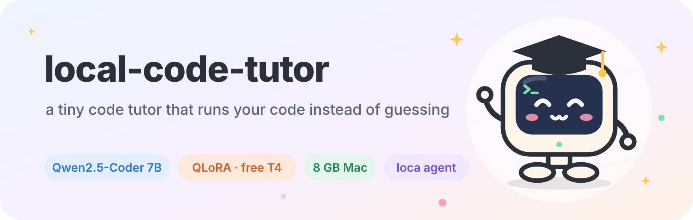

# Local Code Tutor

### Fine-tune Qwen2.5-Coder-7B for free and run a coding agent that *runs your code instead of guessing* — on an 8 GB MacBook

[](https://github.com/pnnnx/local-code-tutor/actions)


**Execution-verified training data · QLoRA on a free GPU · GGUF on Apple Silicon · agent with measured fixes for 7B failure modes · LoRA/weight analysis with charts**

[Goal](#goal) · [At a glance](#at-a-glance) · [Results](#results) · [Quick start](#quick-start) · [How it works](#how-it-works) · [Lessons learned](#lessons-learned) · [Roadmap](#roadmap) · [Русская версия](README.ru.md)

</div>

## Meet Lo

<table align="center">
<tr>
<td align="center" width="20%">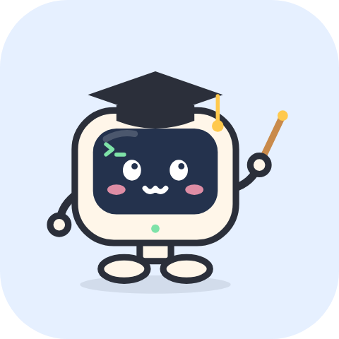<br><b>explains</b><br><sub>mechanism, <i>why</i>, the trap, the fix</sub></td>
<td align="center" width="20%"><br><b>thinks out loud</b><br><sub>you see the reasoning live</sub></td>
<td align="center" width="20%"><br><b>grumpy mode</b><br><sub>a tired senior, opt-in only</sub></td>
<td align="center" width="20%">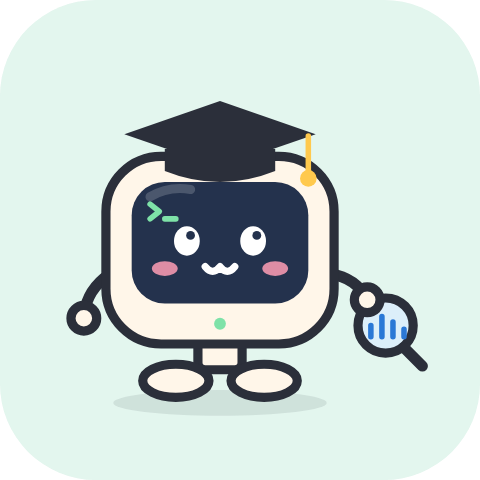<br><b>looks inside</b><br><sub>LoRA &amp; weight charts</sub></td>
<td align="center" width="20%"><br><b>olympiad mode</b><br><sub>coming soon</sub></td>
</tr>
</table>

Lo is the project mascot: a small terminal in a graduation cap — a tutor that lives on your laptop.

## Goal

**Give every student a private, free code tutor that runs on their own laptop — and never states
something about code that it hasn't checked.**

A 2nd-year student shouldn't need a paid cloud subscription to get a patient explanation of *why*
their code behaves the way it does. This project aims to show that a **7B model on an 8 GB laptop**
can be that tutor — if the system around it is built so the model doesn't have to guess:

- **Explain, don't paraphrase** — name the language mechanism, show *why* step by step, point out the
  trap, give the fix. In the student's own language.
- **Verify, don't guess** — outputs, errors and "is it done?" come from running code, never from the
  model's memory.
- **Go beyond toy snippets** — whole programs ("how does this system work?"), data analysis
  (pandas, SQL, dashboards) and looking *inside* neural networks with charts.
- **Reproducible for $0** — a recipe anyone can repeat: free GPU for training, local inference, every
  decision and measurement documented.

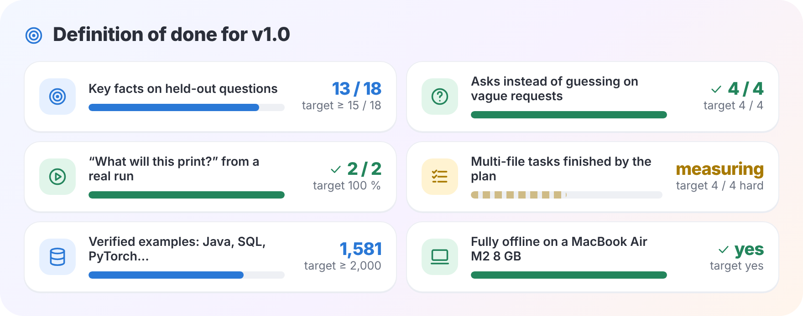

<details><summary>Text version</summary>

**Definition of done for `v1.0`** — each item is measurable with the tools in this repo:

| Goal | Target | Now |
|---|---|---|
| Key facts on held-out questions | ≥ 15 / 18 | 13 / 18 |
| Agent asks instead of guessing on vague requests | 4 / 4 | ✅ 4 / 4 |
| "What will this print?" answered from a real run | 100 % | ✅ 2 / 2 |
| Multi-file tasks finished by the plan, not by luck | 4 / 4 hard tasks | measuring |
| Verified examples, incl. Java, SQL analytics, PyTorch | ≥ 2,000 | 1,581 |
| Runs fully offline on a MacBook Air M2 8 GB | yes | yes |

</details>

**Non-goals:** competing with frontier cloud models on large refactors or deep reasoning; being a
general-purpose chatbot. The target is narrow on purpose — *understanding code you're learning from*.

## At a glance

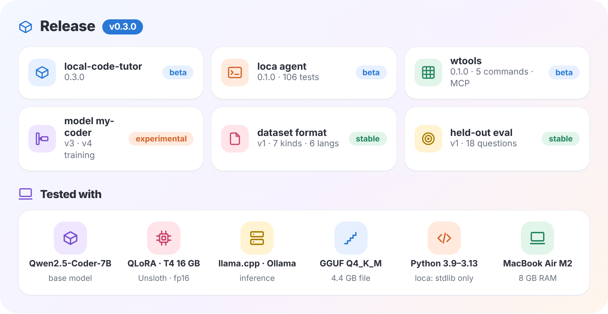

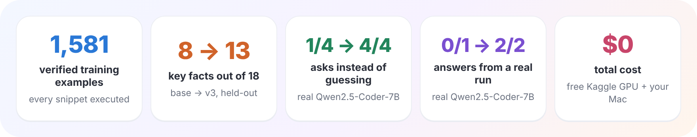

<details><summary>Text version</summary>

<table>
<tr><td valign="top" width="52%">

**Release `v0.3.0`**

| Component | Version | Status |
|---|---|---|
| **local-code-tutor** (this repo) | `0.3.0` |  |
| **[loca](https://github.com/pnnnx/loca)** agent | `0.1.0` · 106 tests |  |
| **wtools** weight analysis | `0.1.0` · 5 commands · MCP |  |
| Fine-tuned model **my-coder** | `v3` · LoRA r=32 · 954 + 300 examples |  |
| Dataset format | `v1` · 7 kinds · 6 languages |  |
| Held-out eval | `v1` · 18 questions · auto-scored |  |

</td><td valign="top" width="48%">

**Tested with**

| Stack | Version |
|---|---|
| Base model | Qwen2.5-Coder-7B-Instruct |
| Training | Unsloth QLoRA 4-bit · Kaggle T4 16 GB · fp16 |
| Inference | llama.cpp `0.7.0-dev` (`1b29621`) · Ollama |
| Quantization | GGUF `Q4_K_M` · 4.4 GB file · ~4.7 GB RAM |
| Python | `3.9` – `3.13` (loca: stdlib only) |
| PyTorch | `2.14` CPU · safetensors `0.8` · matplotlib `3.11` |
| Hardware | MacBook Air M2 **8 GB** · Kaggle T4 |

</td></tr>
</table>

| Metric | Value |
|---|---|
| Verified training examples | **1,581** and growing (target ≈ 2,600) across 20+ categories |
| Held-out key facts, base → v2 → v3 | **8 / 18 → 9 / 15 → 13 / 18** ([details](docs/RESULTS.md)) |
| Agent failure mode #8 "guesses instead of asking" | **1 / 4 → 4 / 4** on real Qwen2.5-Coder-7B |
| Agent failure mode #4 "can't run code in its head" | **0 / 1 → 2 / 2** on real Qwen2.5-Coder-7B |
| Cost | **$0** — free Kaggle GPU, local inference |

</details>

---

Small local models are great at *sounding* right. Ask a 7B model "what does this print?" and it will
confidently invent the output. This project is built around one rule:

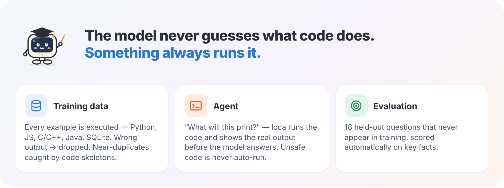

<details><summary>Text version</summary>

> **The model never guesses what code does. Something always runs it.**

| Where | How the rule is enforced |
|---|---|
| **Training data** | Every example is executed (Python, JS, C/C++, Java, SQLite). If the answer disagrees with the real output, the example is dropped. Near-duplicates are caught by comparing code *skeletons* (identifiers → `ID`, literals → `S`/`N`). |
| **Agent** | When you ask "what will this print / why does it crash", the [loca](https://github.com/pnnnx/loca) agent shows the model the source **and runs it before the model answers**. Unsafe code (deletes files, network, `input()`) is never auto-run. |
| **Evaluation** | 18 held-out questions that never appear in training, scored automatically on key facts. |

</details>

Everything below runs on a **MacBook Air M2 with 8 GB RAM**; training uses the **free Kaggle T4**.

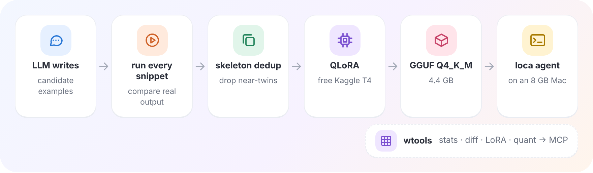

<details><summary>Diagram source (Mermaid)</summary>

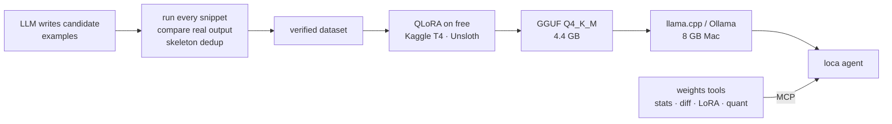

</details>

## Results

All numbers are measured, including the ones that didn't go my way.

### 1. Fixing 7B failure modes inside the agent

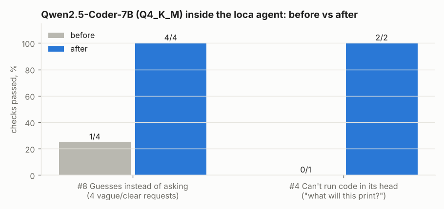

Measured on the real thing: **Qwen2.5-Coder-7B-Instruct Q4_K_M** in `llama-server`, with a probe
harness that runs the same requests before and after each fix (`bench/probe.py` in loca).

- **#8 "Guesses instead of asking" — 1/4 → 4/4.** On vague requests ("add promo codes") the model
  invented a goal and even marked existing files as "(new)". Fix: a *task spec* step (goal, files,
  constraints, a runnable done-check, assumptions, questions) plus deterministic post-checks that don't
  trust the model — paths are verified against the disk, and a vague request with no questions gets one.
  Now the model itself asks: *which promo codes, where are they stored, how do they affect the total?*
- **#4 "Can't execute code in its head" — 0/1 → 2/2.** A "run it first" reminder was simply **ignored**:
  asked about `tricky.py`, the model replied *"that file doesn't exist"* without calling a single tool.
  Fix: the agent runs the code itself and puts the source + real output in context before the model speaks.

### 2. Fine-tuning: v2 learned the *form*, v3 started getting the *facts*

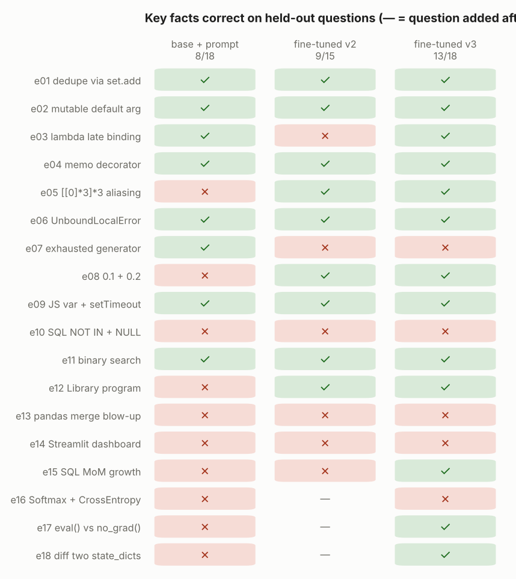

<sub>* v2 was evaluated before PyTorch questions e16–e18 were added.</sub>

**v2** answered exactly in the target style (verdict first, precise mechanism, fixed code) — **but
confidently invented outputs**: `[3, 3, 3]` instead of `[2, 2, 2]`, "6" instead of 14. **v3** added
pandas, SQLite analytics, PyTorch and weight-analysis examples: late binding is now right, the SQL
answer uses SQLite's `STRFTIME` + `LAG`, the PyTorch questions pass. It **still can't do arithmetic in
its head** (e07, e13) — which is exactly why the agent runs code instead of trusting the model.
Details: [docs/RESULTS.md](docs/RESULTS.md).

### 3. Look inside the network — with charts

`wtools/weights.py` (CLI + MCP server, so the agent can call it):

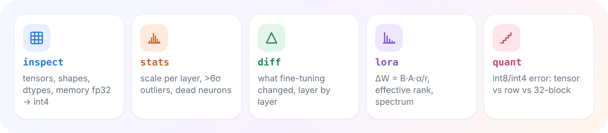

<details><summary>Text version</summary>

| Command | What you learn |
|---|---|
| `inspect` | tensors, shapes, dtypes, memory at fp32 / fp16 / int8 / int4, biggest blocks |
| `stats` | per-layer scale, >6σ outliers, dead neurons, sparsity, weight histogram |
| `diff` | what fine-tuning changed: ‖ΔW‖/‖W‖ and cosine per layer and per module type |
| `lora` | ΔW = B·A·α/r per module, effective rank, energy in the top direction, spectrum — via QR on r×r, fast even for 7B |
| `quant` | int8/int4 error per layer: per-tensor vs per-row vs 32-block scales (the GGUF idea) |

</details>

<p align="center">
  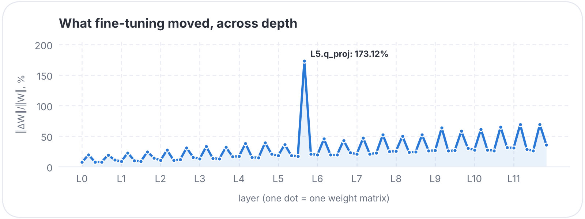
  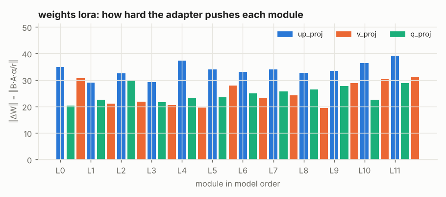
</p>

<sub>Toy model from the test suite. The agent can't see images, so every number on a chart is also
printed as text — the model explains the chart from the numbers.</sub>

## Quick start

**Analyze a LoRA adapter or a checkpoint** (any PEFT adapter / safetensors / `.pt`):

```bash
pip install torch safetensors matplotlib
python3 wtools/weights.py lora   path/to/lora_adapter        # what did fine-tuning actually do?
python3 wtools/weights.py diff   base.safetensors tuned.safetensors
python3 wtools/weights.py quant  model.safetensors --bits 4
```

**Fine-tune your own tutor on a free GPU:** open `kaggle_qwen_coder_finetune_v2.ipynb` on Kaggle
(GPU T4 × 1), upload your `explain_*.jsonl`, *Run All*. You get a LoRA adapter, a held-out evaluation
and a `Q4_K_M` GGUF ready for llama.cpp / Ollama.

**Build a verified dataset:**

```bash
cd ds && ./ds.sh            # pick a topic → prompt goes to clipboard → paste the LLM's answer back
./ds.sh status              # coverage per category vs targets
./ds.sh build               # re-run everything, dedup, write the training file
```

**Run it locally with the agent:**

```bash
llama-server -m my-coder-v2-Q4_K_M.gguf --jinja -c 8192 -fa on -ctk q8_0 -ctv q8_0
loca --backend llamacpp                     # https://github.com/pnnnx/loca
python3 wtools/install_loca.py              # give the agent the weight-analysis tools
```

## How it works

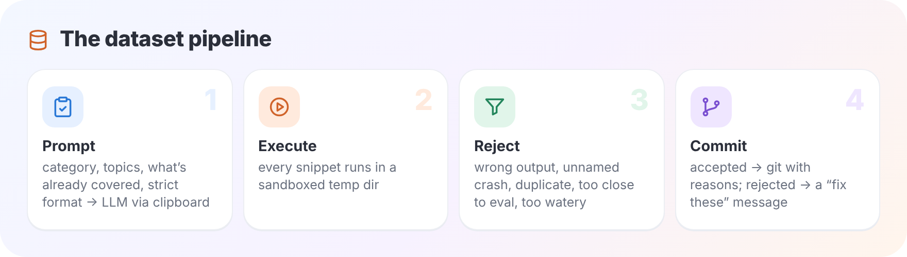

<details><summary>Text version</summary>

1. A prompt with the category, topics, *what is already covered* and strict format rules goes to an
   LLM (ChatGPT or Claude) via the clipboard.
2. The answer is parsed and **every snippet is executed** in a sandboxed temp dir (`runner.py`).
3. `build.py` rejects an example if: the stated output doesn't match the real one, it crashes without
   naming the exception, the "write code" answer doesn't contain the code, it's a skeleton-duplicate of
   anything already accepted, it's too close to a held-out question, or it's too short / long / watery.
4. Rejections are turned into a "fix these" message for the same chat; accepted examples are committed
   to git automatically with the rejection reasons in the commit message.

</details>

**Training (`kaggle_qwen_coder_finetune_v2.ipynb`)** — Unsloth QLoRA on `Qwen2.5-Coder-7B-Instruct`,
fp16 on T4, `adamw_8bit`, loss on responses only, half of the examples with a system prompt so the model
behaves the same with and without it; then automatic held-out eval and GGUF export.

**The agent ([loca](https://github.com/pnnnx/loca))** — a stdlib-only terminal coding agent
for small local models: repo map with signatures and tests per file, read-by-symbol, fuzzy edits, a
plan graph with executable acceptance checks and rollbacks, sub-agents, undo snapshots, hooks, MCP,
Ollama and llama.cpp backends. 106 tests.

## Lessons learned

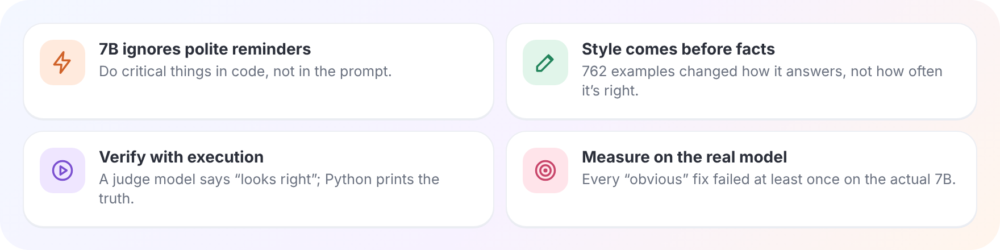

<details><summary>Text version</summary>

- **A 7B model ignores polite reminders.** "Run the code first" in the prompt changed nothing; doing it
  deterministically in the harness fixed it. Prefer code paths over prompt paths for anything critical.
- **Fine-tuning teaches style long before facts.** 762 examples were enough to change *how* the model
  answers, not enough to make it right more often. Put the verdict *after* a short trace, not before.
- **Verify with execution, not with another LLM.** A judge model says "looks correct"; a Python
  process prints the truth.
- **Measure on the real model.** Every fix that "obviously worked" in unit tests failed at least once on
  the actual 7B before it was adjusted.

</details>

## Roadmap

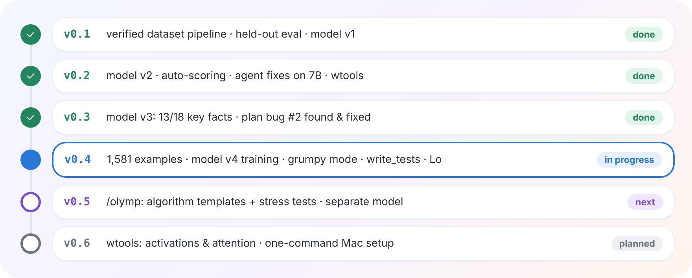

See [docs/PLAN.md](docs/PLAN.md) for the full plan and [CHANGELOG.md](CHANGELOG.md) for what changed.

## Contributing

Issues and PRs are welcome — especially new verified example categories, eval questions and
agent failure modes you've seen with small models. Start with [CONTRIBUTING.md](CONTRIBUTING.md).
Security issues: see [SECURITY.md](SECURITY.md).

## Citation

If you use this in a write-up, there is a [CITATION.cff](CITATION.cff) (GitHub shows "Cite this repository").

## Repository map

| Path | What |
|---|---|
| `ds/` | dataset pipeline: `ds.sh`, `tools/runner.py`, `build.py`, `dedup.py`, `score_eval.py`, prompts |
| `ds/eval_set.py` | 18 held-out questions + key-fact checks |
| `kaggle_qwen_coder_finetune_v2.ipynb` | QLoRA training → adapter + eval + GGUF |
| `loca_bench_kaggle_v2.ipynb` | agent benchmark + failure-mode probe on a GPU |
| `wtools/` | weight analysis CLI, MCP server, tests |
| `docs/` | plan, decisions, failure modes, results, a journal of every step |
| `results/` | raw model answers on the held-out set |

The training data itself is **not** published: examples were generated with ChatGPT and Claude, whose
terms restrict using outputs to train models. The pipeline, checks and results are all here — point it
at your own generator.

## FAQ

**Does a 7B model really run on 8 GB?** Yes: Q4_K_M is ~4.7 GB of RAM; use 4–8k context with a q8_0 KV cache.

**Why does the model explain in Russian?** That's the author's target audience. Nothing in the pipeline
is language-specific — change the prompts in `ds/tools/gpt_data.json` and the style checks in `build.py`.

**How was this built?** By a 2nd-year applied-math student, together with an AI assistant (Claude) —
you'll see it in the commit trailers. Decisions, measurements and dead ends are documented in `docs/`.

## Acknowledgements

[Qwen2.5-Coder](https://github.com/QwenLM/Qwen2.5-Coder) (Apache 2.0) ·
[Unsloth](https://github.com/unslothai/unsloth) · [llama.cpp](https://github.com/ggml-org/llama.cpp) ·
[Ollama](https://ollama.com) · free GPUs from [Kaggle](https://www.kaggle.com)

## License

MIT — see [LICENSE](LICENSE). If this saved you some GPU hours, a ⭐ helps others find it.
