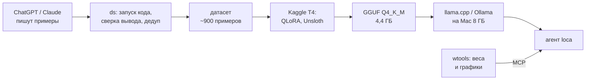
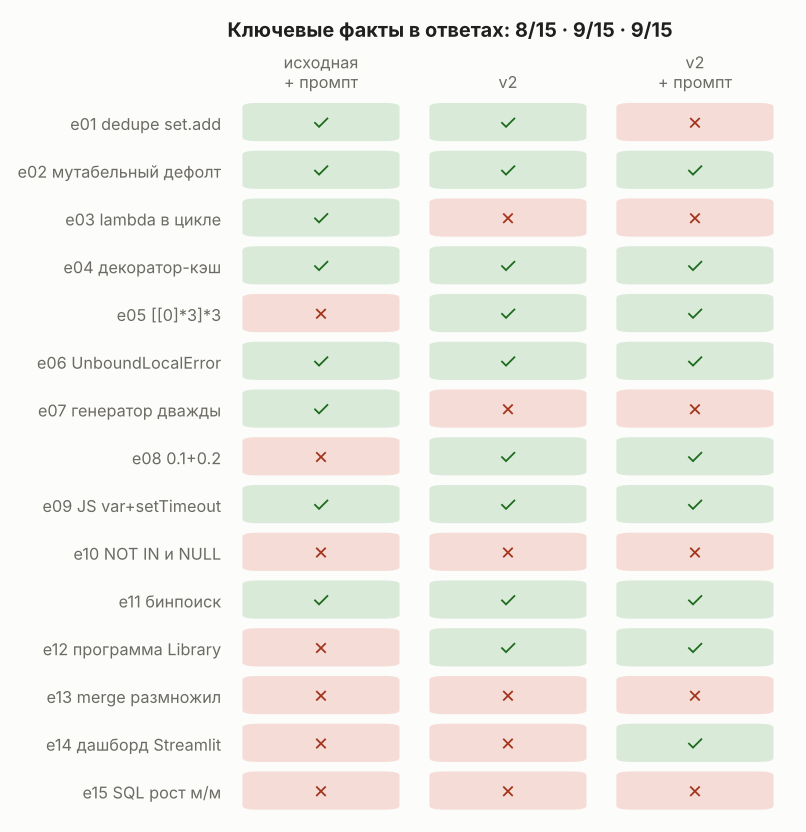

# Local Code Tutor — локальный 7B-наставник по коду, который не угадывает, а проверяет

[English](README.md)

<!-- EN: see README.md -->
**EN (short):** a local code tutor on a MacBook Air M2 / 8 GB. Qwen2.5-Coder-7B fine-tuned with QLoRA
on a free Kaggle T4 to explain code in Russian. Every training example is **verified by actually
running its code**: if the answer's output disagrees with the real one, the example is dropped.
The agent [loca](https://github.com/pnnnx/loca) runs the code before the model answers
"what will this print?", and asks clarifying questions instead of guessing. All claims below are measured.
`wtools/` adds weight analysis with charts (layer stats, checkpoint diff, LoRA spectrum, quantization error)
as MCP tools for the agent.

---

Студенческий проект: своя модель-помощник по коду, которая работает на ноутбуке и объясняет
по-русски — механизм, «почему так», подвохи, аналитику (pandas, SQL, дашборды) и веса нейросетей.

## Цель проекта

**Дать каждому студенту бесплатного и приватного наставника по коду, который работает на его
ноутбуке и никогда не утверждает о коде того, что не проверил.**

- **Объяснять, а не пересказывать:** механизм языка, «почему так» по шагам, подвох, исправление —
  на языке студента.
- **Проверять, а не угадывать:** вывод, ошибки и «готово ли» берутся из запуска кода.
- **Не только фрагменты:** программы целиком («как устроена система»), аналитика (pandas, SQL,
  дашборды) и разбор весов нейросетей с графиками.
- **Повторяемо за $0:** бесплатный GPU для обучения, локальный запуск, все решения и замеры записаны.

Критерии `v1.0`: ≥ 13/15 фактов на контрольных вопросах (сейчас 9/15), вопросы вместо догадок 4/4 (✅),
вывод только из запуска (✅), план доводит 4/4 сложных задачи (замеряется), ≥ 2000 проверенных
примеров (сейчас 900+), полностью офлайн на MacBook Air M2 8 ГБ (✅).
Не цель: соревноваться с облачными моделями на больших рефакторингах и быть чат-ботом общего назначения.

## Главная идея

Маленькая модель (7B) не может выполнить код «в уме», поэтому в этом проекте модель вывод
не угадывает. Это касается всех трёх частей:

| Где | Как |
|---|---|
| **Данные** | каждый пример реально запускается (Python, JS, C/C++, Java, SQLite); ответ, не совпавший с настоящим выводом, отбрасывается; дубли ищутся по «скелету» кода (имена → ID) |
| **Агент** | на «что выведет / почему падает» loca сама показывает модели исходник и запускает код **до** её ответа |
| **Проверка** | 18 отложенных вопросов, которых нет в обучении, + автопроверка ключевых фактов |



## Результаты (честно, включая то, что не получилось)

### Агент на настоящей 7B: узкие места маленькой модели


- **№8 «додумывает вместо того, чтобы спросить».** На размытых просьбах («добавь промокоды») 7B
  придумывала цель. Задание перед работой + проверка задания в коде (пути сверяются с диском,
  размытая просьба без вопросов получает вопрос): **1/4 → 4/4**.
- **№4 «не может выполнить код в уме».** Напоминание «сначала запусти» модель **игнорировала** — на
  вопрос про файл ответила «файла не существует», не вызвав ни одного инструмента. Теперь агент
  запускает код сам (опасный — не запускает): **0/1 → 2/2**, объяснение по настоящим строкам исходника.

Прогоны: Qwen2.5-Coder-7B-Instruct Q4_K_M, llama-server, `bench/probe.py` в репозитории loca.

### Дообучение v2: форма выучена, конкретика — нет



762 своих примера + 300 общих, 2 эпохи, LoRA r=32. По автопроверке фактов — **8/15 → 9/15**.
v2 отвечает как задумано (итог, точное название механизма, исправленный код), **но уверенно
выдумывает конкретный вывод**: `[3, 3, 3]` вместо `[2, 2, 2]` (e03), «6» вместо 14 (e07). Аналитика
слабая у обеих версий — данных было мало. Выводы для v3 — в [docs/RESULTS.md](docs/RESULTS.md):
трассировка перед итогом, больше SQL (именно SQLite) и pandas, Java.

### Анализ весов с графиками (`wtools`)

| команда | что показывает |
|---|---|
| `inspect` | тензоры, формы, память fp32 / fp16 / int8 / int4 |
| `stats` | масштаб весов по слоям, выбросы > 6σ, «мёртвые» нейроны |
| `diff` | что изменилось после дообучения: ‖ΔW‖/‖W‖, косинус по слоям |
| `lora` | ΔW = B·A·α/r: норма по модулям, эффективный ранг, спектр (через QR — быстро и для 7B) |
| `quant` | ошибка int8/int4: масштаб на тензор / строку / блок 32 (как в GGUF) |

<p> </p>

*Графики на игрушечной модели из тестов.* Модель в loca картинки не видит, поэтому все числа с графика
дублируются в тексте — она объясняет их по числам.

## Что внутри

| Путь | Что это |
|---|---|
| `ds/` | сбор датасета: `./ds.sh` (ChatGPT/Claude через буфер обмена → запуск → проверки → git) |
| `ds/tools/runner.py`, `build.py`, `dedup.py` | запуск кода, проверки ответа, дубли по «скелету» |
| `ds/eval_set.py`, `ds/tools/score_eval.py` | отложенные вопросы и автопроверка фактов |
| `kaggle_qwen_coder_finetune_v2.ipynb` | обучение QLoRA на Kaggle → LoRA + GGUF + проверка |
| `loca_bench_kaggle_v2.ipynb` | бенчмарк агента и пробник узких мест на GPU |
| `wtools/` | анализ весов: CLI + MCP-сервер для loca |
| `docs/` | план, решения, узкие места, результаты, журнал каждого шага |

Сам датасет не публикуется: примеры сгенерированы ChatGPT и Claude, и условия их использования
для обучения моделей — серая зона. Опубликованы конвейер, проверки и результаты.

## Запуск

```bash
pip install torch safetensors matplotlib numpy pandas   # для проверки примеров и wtools
cd ds && ./ds.sh                                        # сбор: выбрать тему и идти по шагам
python3 wtools/weights.py lora path/to/lora_adapter     # разбор адаптера с графиками
python3 -m pytest -q wtools/test_weights.py
```

## Как сделано

Код писался вместе с ИИ-ассистентом (Claude) — это видно в коммитах. Решения, замеры и разбор
результатов — в `docs/`: [план](docs/PLAN.md), [решения](docs/DECISIONS.md),
[узкие места](docs/BOTTLENECKS.md), [журнал](docs/JOURNAL.md).

Лицензия — MIT. Базовая модель Qwen2.5-Coder-7B — Apache 2.0.
