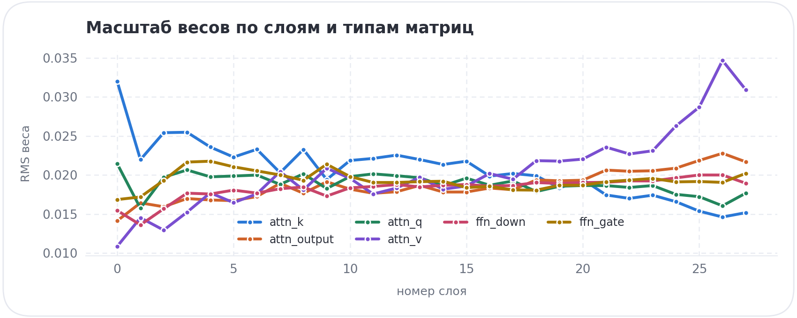
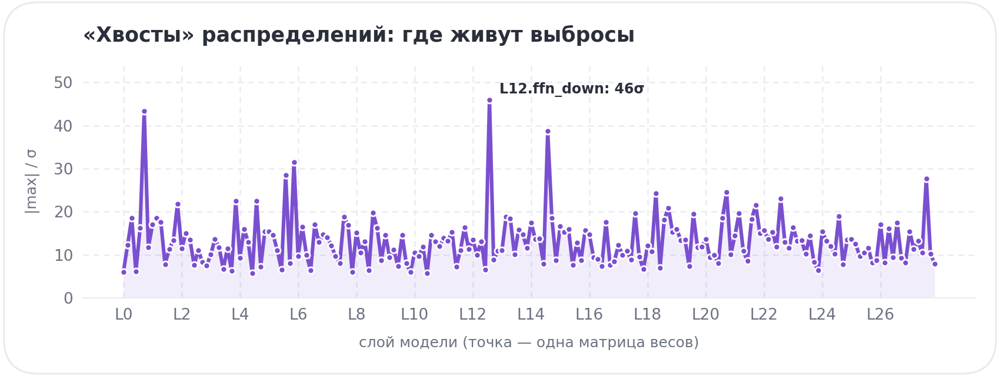
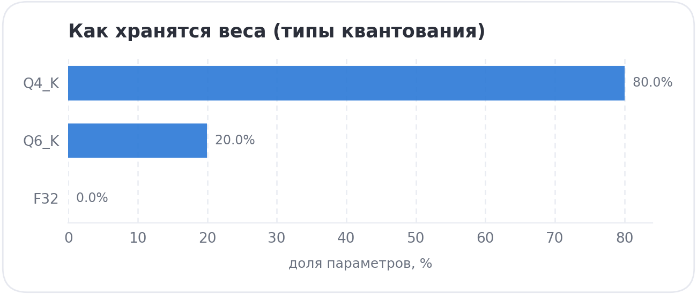

# Снимок my-coder v4 — 2026-10-21

Всё, чтобы воспроизвести и проверить модель v4: сами веса в git не лежат (4,4 ГБ, `~/models`),
но по `sha256` любой файл можно сверить, а по датасету и ноутбуку — пересобрать.

| что | значение |
|---|---|
| модель | `my-coder-v4-Q4_K_M.gguf` · 4.36 GiB · 7,615,616,512 параметров |
| sha256 модели | `a5ab2658375bdf4aed925052c87f1241c03554feae2893baf77a13cf7af5d832` |
| квантование | Q4_K_M: Q4_K 80% · Q6_K 20% |
| шаблон чата | tools: есть · sha `93ece0037c37d080` |
| датасет | `ds/explain_ru_train.jsonl` · 1581 примеров (39 «ворчун») · sha256 `0e0e96d41cc0b8e6…` |
| обучение | "unsloth/Qwen2.5-Coder-7B-Instruct-bnb-4bit" · LoRA r=32 · lr 1e-4 · 2 эпохи · 1920 строк · 190 мин на T4 |
| loss | 1.466 → 0.943 (средний 1.028) |
| контрольные вопросы | база+промпт 8/18 · **v4 13/18** · v4+промпт 11/18 |
| код | коммит `341704b` |

Файлы: `MANIFEST.json` (всё это машинно), `snapshot.json` (статистика каждого из 339 тензоров по
выборке 128 строк), `SNAPSHOT_weights.md` (таблицы), графики ниже. Сверить модель:
`shasum -a 256 ~/models/my-coder-v4-Q4_K_M.gguf`.

